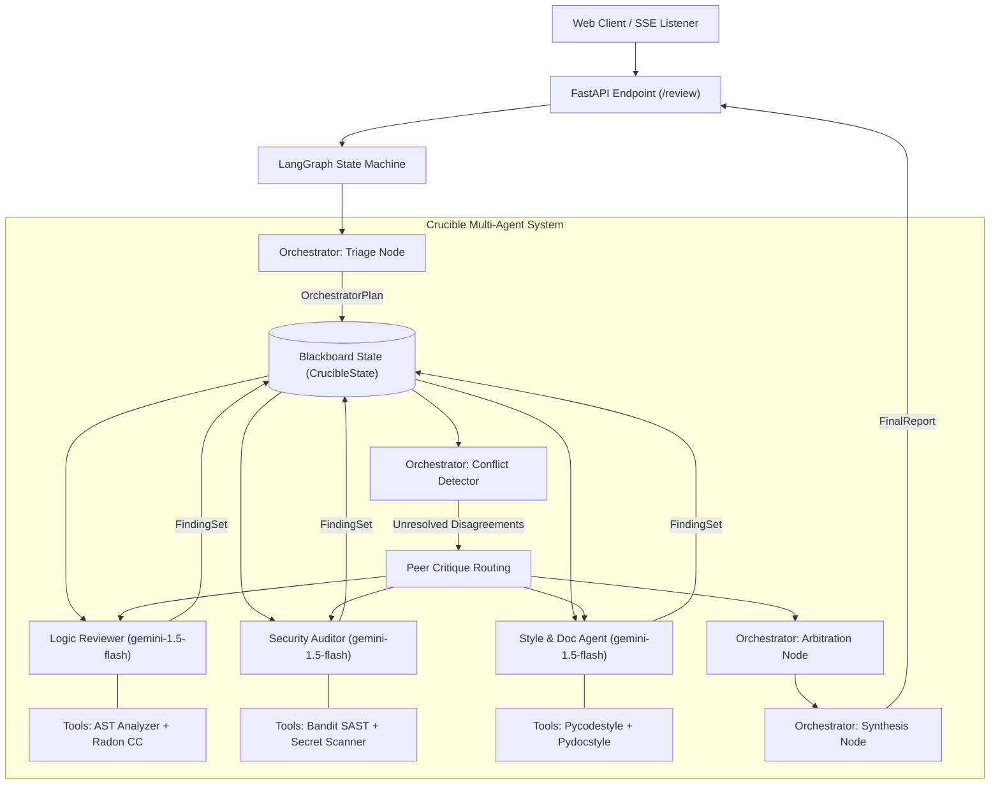

# Crucible — System Architecture & Design Document

**Project Name:** Crucible  
**Subtitle:** Multi-Agent Code Review & Autonomous Arbitration Studio  
**Course Code:** CA3 / Flexi-CA3  
**Lead Architect:** Aayush Joshi (`Aayush2308`)  
**Specialist Contributors:** Anum Agarwal (`anum777`), Anushka Desai (`anushkadesai13`), Arya Shah (`Arya-A-Shah`)  

---

## 1. System Architecture & Topology

Crucible implements a hybrid **Blackboard + Dynamic Peer-Critique + Hierarchical Arbitration** multi-agent topology orchestrated via LangGraph.

---

## 2. Agent Roles and Specifications

| Agent | Class | LLM Model | Tools | Core Responsibility |
| :--- | :--- | :--- | :--- | :--- |
| **Orchestrator** | `Orchestrator` | `gemini-2.0-flash` | Blackboard, LangGraph Router | Evaluates code complexity, dispatches specialists, detects conflicts, arbitrates disagreements, and synthesizes final verdict. |
| **Logic Reviewer** | `LogicReviewer` | `gemini-1.5-flash` | AST Visitor, Radon Cyclomatic Complexity | Inspects algorithmic soundness, off-by-one errors, unreachable blocks, and complexity limits. |
| **Security Auditor** | `SecurityAuditor` | `gemini-1.5-flash` | Bandit SAST, Regex Secret Detector | Scans for SQLi (CWE-89), hardcoded tokens (CWE-798), and unsafe standard library usage. |
| **Style & Doc Agent** | `StyleDocAgent` | `gemini-1.5-flash` | Pycodestyle (PEP 8), Pydocstyle (PEP 257) | Identifies naming anti-patterns, line length issues, and missing docstrings. |

---

## 3. Autonomous Decision Making & Non-Hardcoded Routing

Crucible does **not** rely on rigid sequential pipelines. Every routing decision is made dynamically based on LLM outputs:
1. **Dynamic Triage:** The Orchestrator inspects the code length and context to determine which agents to invoke and in what order.
2. **Conflict Resolution & Arbitration:** When two agents disagree on severity or classification (e.g. Logic flags a boundary bug while Security flags SQL injection on the same line), the Orchestrator initiates peer critique. If consensus is not reached, the Orchestrator's arbitration node issues a binding `ArbitrationRuling`.
3. **Termination Guard:** A hard budget (`budget_rounds = 3`) prevents infinite review cycles, guaranteeing state machine convergence.

---

## 4. Robustness & Fault Tolerance (Category C2)

Crucible incorporates automated exception containment and graceful tool fallback:
- All static tool invocations execute through `tools/tool_base.run_tool()`.
- If an underlying tool fails (e.g. Bandit crashing or unparseable AST), the agent emits a `fallback` TraceEvent and continues analysis using pure LLM reasoning.
- Simulated fault injection (`CRUCIBLE_FAULT=bandit_scanner`) verifies that the system does not crash and completes its review under failure conditions.
